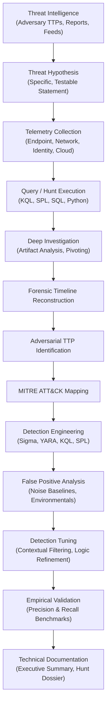

# Threat Research & Hunting Detection Lab

[](https://github.com/your-username/threat-research-lab/actions)
[](https://github.com/your-username/threat-research-lab/actions)
[](https://opensource.org/licenses/Apache-2.0)
[](https://python.org)
[](https://attack.mitre.org/)
[](https://github.com/SigmaHQ/sigma)

A comprehensive, production-grade cybersecurity research laboratory and hands-on training platform built for **Threat Researchers**, **Managed Threat Hunters**, and **Detection Engineers**. 

This platform bridges theoretical security concepts with empirical, telemetry-driven investigation. It provides hands-on investigative scenarios across network flows, endpoint telemetry, Windows Sysmon, Linux auditd, cloud audit logs (AWS, Azure, GCP), Zero Trust architectures (Zscaler ZIA/ZPA), and automated detection engineering.

---

## 🎯 Primary Purpose & Target Role

This repository is engineered specifically to develop and showcase capabilities expected of a **Threat Researcher / Managed Threat Hunting Intern**:

* **Hypothesis-Driven Threat Hunting**: Formulating actionable hypotheses from threat intelligence and empirical anomaly baselines.
* **Multi-Source Telemetry Correlation**: Fusing endpoint (Sysmon, EDR), network (Zeek, PCAP, NetFlow), identity (Active Directory, Entra ID), and proxy telemetry.
* **Adversarial TTP Deconstruction**: Mapping real-world adversary behavior directly to MITRE ATT&CK tactics, techniques, and sub-techniques.
* **Detection Engineering Lifecycle**: Designing robust behavioral detections (Sigma, YARA, KQL, SPL) optimized for high precision and recall.
* **Detection Tuning & Noise Reduction**: Empirically measuring false-positive rates, analyzing noise factors, and establishing defensible suppression baselines.
* **Detection-as-Code (DaC)**: Implementing Git-based CI/CD workflows with automated syntax linting, schema validation, and regression testing.
* **Zero Trust & Cloud Threat Research**: Analyzing modern enterprise perimeter defense models (SSE, SASE, SWG, ZIA, ZPA) and multi-cloud attack vectors.

---

## 🔄 The Threat Research & Hunting Lifecycle

Every major investigation in this lab follows an end-to-end operational workflow:



---

## 🗺️ Lab Roadmap & Architecture

The laboratory is organized into 20 progressive modules across 4 competency phases:

| Lab | Title | Focus Area | Difficulty | Telemetry / Tools |
| :-- | :--- | :--- | :---: | :--- |
| **01** | [Threat Hunting Foundations](labs/01-threat-hunting-foundations/) | Hypothesis formulation, IOC vs Behavioral | 🟢 Beginner | Auth, Process, DNS, Network |
| **02** | [Network Threat Hunting](labs/02-network-hunting/) | Port scans, C2 beaconing, SMB brute force | 🟢 Beginner | Zeek Conn logs, PCAP, Wireshark |
| **03** | [DNS Covert Channel Hunting](labs/03-dns-hunting/) | DNS Tunneling, DGA, NXDOMAIN bursts | 🟡 Intermediate | DNS Query Telemetry, Entropy |
| **04** | [HTTP/TLS Threat Hunting](labs/04-http-tls-hunting/) | Jittered C2, JA3/JA4 fingerprints, Certs | 🟡 Intermediate | Proxy Logs, TLS Handshakes |
| **05** | [Windows Telemetry & Sysmon](labs/05-windows-telemetry/) | Office macros, AMSI bypass, LSASS dump | 🟡 Intermediate | Sysmon EID 1/3/10/11, Security 4688 |
| **06** | [Linux Telemetry & Auditing](labs/06-linux-telemetry/) | Web shells, sudo abuse, systemd units | 🟡 Intermediate | Linux Auditd, auth.log, bash |
| **07** | [Advanced Endpoint Hunting](labs/07-endpoint-hunting/) | LOLBAS, PPID Spoofing, ADS execution | 🔴 Advanced | EDR Process Lineage, Tokens |
| **08** | [MITRE ATT&CK Operationalization](labs/08-mitre-attack/) | Deconstructing raw intrusions into ATT&CK | 🟢 Beginner | Enterprise Matrix v14, Data Sources |
| **09** | [Threat Intelligence Analysis](labs/09-threat-intelligence/) | Fact vs Analysis vs Hypothesis, Diamond Model | 🟡 Intermediate | Volt Typhoon / Midnight Blizzard |
| **10** | [Kusto Query Language (KQL) Masterclass](labs/10-kql/) | 15 hands-on production hunting queries | 🟢 Beginner / 🟡 | Microsoft Sentinel / Defender schema |
| **11** | [Splunk SPL Masterclass](labs/11-splunk/) | 15 hands-on enterprise hunting queries | 🟡 Intermediate | Splunk Enterprise / BOTS schema |
| **12** | [Detection Engineering Principles](labs/12-detection-engineering/) | Fidelity, Pyramid of Pain, Alert Logic | 🟡 Intermediate | Behavioral Detection, Context |
| **13** | [Sigma Rule Engineering](labs/13-sigma/) | Authoring & validating 5 Sigma rules | 🟢 Beginner / 🟡 | Sigma CLI, pySigma, YAML |
| **14** | [YARA Malware Hunting](labs/14-yara/) | 5 safe string, hex & PE rules | 🟡 Intermediate | YARA, Safe Benign Samples |
| **15** | [Detection Tuning & Noise Reduction](labs/15-detection-tuning/) | Tuning noisy alert across 5,000+ events | 🟡 Intermediate | Precision/Recall, Suppression |
| **16** | [Python Security Automation](labs/16-python-security-automation/) | 5 modular security investigation tools | 🟡 Intermediate | Python 3, CLI, Requests, Scapy |
| **17** | [Multi-Cloud Threat Hunting](labs/17-cloud-hunting/) | AWS CloudTrail, Azure Entra ID, GCP Audit | 🟡 Intermediate | CloudTrail JSON, Entra Sign-ins |
| **18** | [Zscaler & Zero Trust Architecture](labs/18-zscaler-security-model/) | SSE, ZIA Web logs, ZPA micro-segmentation | 🟡 Intermediate | Cloud SWG, SSL Inspection, ZDX |
| **19** | [Detection-as-Code Pipeline](labs/19-detection-as-code/) | Git PR workflow, automated CI linting | 🔴 Advanced | GitHub Actions, Python Linting |
| **20** | [Capstone: Operation NightHawk](labs/20-capstone/) | Full multi-stage enterprise APT breach | 🔴 Advanced | Full-Stack Multi-Source Dossier |

---

## 🏗️ Repository Structure

```text
threat-research-lab/
├── README.md                      # Comprehensive laboratory handbook
├── CONTRIBUTING.md                # Contribution guidelines and code standards
├── LICENSE                        # Apache 2.0 open-source license
├── CHANGELOG.md                   # Version release notes and changes
├── SECURITY.md                    # Vulnerability reporting policy
├── progress.md                    # Interactive progress and skill acquisition tracker
├── Makefile                       # Build, lint, and test automation tasks
├── pyproject.toml                 # Python packaging and tool configuration
├── requirements.txt               # Lab dependencies and Python libraries
├── .env.example                   # Environment configuration template
├── .gitignore                     # Git ignore patterns for security datasets
│
├── docs/                          # In-depth architectural and operational guides
│   ├── learning-roadmap.md        # Recommended study pathways
│   ├── methodology.md             # Threat hunting & detection methodology
│   ├── telemetry-guide.md         # Endpoint, network, identity, cloud telemetry guide
│   ├── investigation-guide.md     # Evidence triage, pivoting, and timeline building
│   ├── detection-engineering.md   # Rule engineering, life cycle, and testing
│   ├── mitre-guide.md             # ATT&CK mapping standard
│   └── reporting-guide.md         # Professional investigation documentation standard
│
├── labs/                          # 20 Hands-on investigation modules
│   └── [01-20]/                   # Standardized lab folders (scenario, tasks, solution)
│
├── datasets/                      # Reference datasets and ingestion schemas
│   ├── README.md                  # Dataset catalogs, schemas, and downloaders
│   ├── network/                   # Network flows, proxy logs, PCAP summaries
│   ├── dns/                       # High-entropy DNS, tunneling, and DGA logs
│   ├── windows/                   # Sysmon, Security Event 4688/4624 records
│   ├── linux/                     # Auditd, auth.log, syslog records
│   ├── authentication/            # Kerberos, NTLM, MFA, and SSO logs
│   └── cloud/                     # AWS CloudTrail, Azure Entra ID audit logs
│
├── detections/                    # Curated production detection repository
│   ├── sigma/                     # Standardized Sigma behavioral detection rules
│   ├── yara/                      # Safe YARA file and memory detection rules
│   ├── splunk/                    # Splunk SPL saved searches and correlation rules
│   ├── kql/                       # Microsoft Sentinel / Defender KQL rules
│   └── correlation/               # Cross-telemetry correlation models
│
├── threat-intelligence/           # Adversary dossiers and intelligence reports
│   ├── actors/                    # Nation-state and eCrime actor profiles
│   ├── campaigns/                 # Deconstructed threat campaigns (Volt Typhoon, etc.)
│   ├── malware/                   # Malware family analysis and capabilities
│   ├── vulnerabilities/           # Critical exploit analyses (Log4j, etc.)
│   └── reports/                   # Standardized intelligence briefs
│
├── investigations/                # Investigation dossiers and evidence tracking
│   ├── templates/                 # Reusable investigation report & timeline templates
│   ├── completed/                 # Reference investigations and case studies
│   └── timelines/                 # Reconstructed incident timelines
│
├── scripts/                       # Python automation and utility toolkit
│   ├── python/                    # Core investigation scripts (IOC parser, analyzers)
│   ├── parsers/                   # Telemetry format converters and normalizers
│   ├── enrichment/                # IP, ASN, WHOIS, and threat reputation helpers
│   └── utilities/                 # Repo validation and dataset acquisition tools
│
├── infrastructure/                # Local deployment and environment automation
│   ├── docker/                    # Docker Compose hunt workbench (Jupyter/DuckDB/Splunk)
│   ├── lab/                       # VM and testbed setup documentation
│   └── configs/                   # Sysmon, Auditd, and Suricata baseline configurations
│
├── tests/                         # Automated validation test suite
│   ├── detections/                # Sigma and YARA syntax and regression tests
│   ├── parsers/                   # Unit tests for Python automation scripts
│   └── validation/                # Repository integrity, links, and schema checks
│
└── .github/workflows/             # Continuous Integration and Detection-as-Code
    ├── test.yml                   # Python test suite and linting workflow
    └── detection-validation.yml   # Automated Sigma, YARA, and rule syntax validation
```

---

## 📋 Standardized Lab Architecture

To maintain rigorous quality across all 20 modules, every lab adheres to a standardized 11-part architecture:

1. `README.md` — Overview, prerequisites, learning objectives, and estimated completion time.
2. `scenario.md` — Realistic threat background, intelligence report trigger, and organizational context.
3. `objectives.md` — Concrete, measurable hunt and detection deliverables.
4. `environment.md` — Telemetry schemas, field dictionaries, hostnames, and IP subnets.
5. `datasets/` — Realistic, structured logs (JSON, CSV, or log format) ready for analysis.
6. `tasks.md` — Step-by-step hands-on investigation tasks and hunting queries.
7. `hints.md` — Tiered hints (Tier 1: Concept, Tier 2: Telemetry field, Tier 3: Query construct).
8. `solutions/` — Complete investigation dossier, timeline reconstruction, and analytical queries.
9. `detections/` — Production-grade Sigma, KQL, SPL, or YARA rules addressing the root TTP.
10. `mitre.md` — Comprehensive mapping to MITRE ATT&CK tactics, techniques, and data sources.
11. `report-template.md` & `validation.md` — Tailored report template and testing/benchmarking guide.

---

## ⚡ Quick Start

### 1. Prerequisites
* Python 3.10+
* Git
* (Optional) Docker & Docker Compose for containerized workbench

### 2. Setup Environment
```bash
# Clone the repository
git clone https://github.com/your-username/threat-research-lab.git
cd threat-research-lab

# Create and activate virtual environment
python -m venv venv
# Windows:
.\venv\Scripts\activate
# Linux/macOS:
source venv/bin/activate

# Install dependencies
pip install -r requirements.txt
```

### 3. Run Repository Integrity & Detections Validation
```bash
# Run automated test suite
pytest tests/ -v

# Run Detection-as-Code linter
python scripts/utilities/validate_repo.py
```

### 4. Begin Your First Investigation
Navigate to [Lab 01: Threat Hunting Foundations](labs/01-threat-hunting-foundations/):
```bash
cd labs/01-threat-hunting-foundations
# Read scenario.md and review tasks.md to begin hunting
```

---

## 🛡️ Safety & Ethics Declaration

All labs, scripts, and datasets in this repository are designed strictly for authorized defensive research, training, and detection engineering:

* **Synthetic & Anonymized Telemetry**: Datasets are synthetically generated or sourced from authorized public research repositories (e.g., Malware Traffic Analysis, Mordor, BOTS).
* **Safe Analysis Standards**: No active weaponized malware binaries are stored in this repository. Malware analysis exercises use harmless test artifacts, mock patterns, and static YARA rules.
* **Non-Attacking Methodology**: No exercises involve unauthorized testing against third-party systems or cloud providers.

---

## 👤 Author & Research Portfolio

This repository represents an ongoing, long-term personal research platform documenting empirical investigations, novel detection logic, and threat intelligence analyses. It is maintained and expanded continuously as an operational portfolio.
