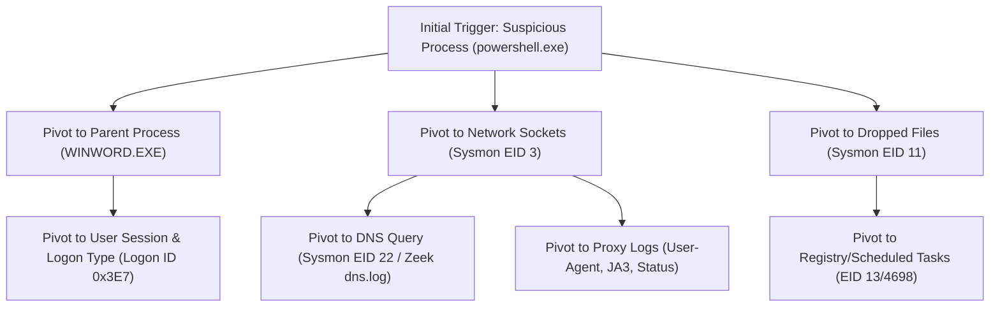

# Incident Investigation & Forensic Analysis Playbook

A structured operational guide for triaging anomalies, pivoting across disparate evidence, and assembling defensible forensic timelines.

---

## 1. Evidence Triage: The 5-W Framework

When an anomaly or hunting alert triggers, answer five essential questions:

1. **Who?**: User account, security identifier (SID), Kerberos principal, or Cloud IAM identity.
2. **What?**: Executed process, modified registry key, queried domain, or initiated API call.
3. **When?**: High-precision UTC timestamp and duration of the anomalous activity.
4. **Where?**: Hostname, source IP, destination IP, subnet, cloud region, or tenant.
5. **Why / How?**: Parent process lineage, authentication context, exploit mechanism, or delivery vector.

---

## 2. The Pivoting Tree

Effective threat hunters do not inspect logs in isolation; they pivot systematically:

---

## 3. Forensic Timeline Construction Rules

A defensible forensic timeline must follow strict standards:
* **All timestamps in UTC**: Never mix local timezone offsets.
* **Corroborate with multiple independent sources**: For example, verify an endpoint network connection (Sysmon EID 3) with firewall flow records (Zeek `conn.log`).
* **Distinguish Fact from Inference**:
  * **Fact**: `10:14:02 UTC - powershell.exe executed with argument -enc KAB...`
  * **Inference / Hypothesis**: `10:14:03 UTC - Adversary likely initiated command and control beacon.`
