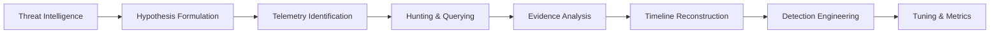

# Threat Hunting & Detection Methodology

Threat hunting is an active, iterative, and hypothesis-driven defensive process aimed at proactively identifying malicious activity that has evaded existing automated detection controls.

---

## 1. The Hunting Lifecycle

### Stage 1: Threat Intelligence & Trigger
Hunting does not begin with random browsing. It is ignited by threat intelligence:
* Documented adversary TTPs (e.g., CISA advisories, ThreatLabz reports, Mandiant M-Trends).
* Emerging vulnerabilities (e.g., zero-day exploitation chains, living-off-the-land techniques).
* Environment anomalies (e.g., rare outbound destination ports, unexpected parent processes).

### Stage 2: Hypothesis Formulation
A valid threat hunting hypothesis must be:
* **Specific**: Identifies an explicit adversary behavior (e.g., "An adversary is using PowerShell download cradles to stage payloads in memory").
* **Testable**: Relies on specific telemetry sources that exist in the environment.
* **Empirical**: Capable of being validated or refuted through data.

**Anti-Pattern**: *"Let's see if we have malware on our network."* (Too vague, unmeasurable).  
**Best Practice**: *"Adversaries may execute `certutil.exe` with `-urlcache` parameters to bypass web proxy restrictions and download staging artifacts to `C:\ProgramData`."*

### Stage 3: Telemetry Identification & Collection
Identify the exact data sources required to test the hypothesis:
* Endpoint: Process creation logs (Sysmon Event ID 1 / Windows Security 4688) with full command-line arguments.
* Network: DNS query telemetry (Sysmon Event ID 22 / Zeek `dns.log`) to verify resolution of downloaded hostnames.
* File System: File creation events (Sysmon Event ID 11) within `C:\ProgramData\*`.

### Stage 4: Hunt Execution & Querying
Deploy search queries (KQL, SPL, SQL, Python) designed to isolate outliers:
* **Long-Tail Analysis**: Identifying rare commands, unusual parent-child process pairs, or infrequent domains.
* **Stack Counting**: Grouping similar command-line structures or parent paths and filtering out ubiquitous administrative scripts.
* **Temporal Clustering**: Looking for rapid sequences of reconnaissance commands within seconds.

### Stage 5: Evidence Analysis & Pivoting
When an anomaly is surfaced, pivot across contextual telemetry:
1. What was the parent process and grandparent process?
2. Which user account and security token launched the process?
3. Did the process establish outbound network connections?
4. Were subsequent child processes or scheduled tasks spawned?

### Stage 6: Forensic Timeline Reconstruction
Construct a chronological timeline capturing every relevant state transition:
* Initial process spawn -> network connection -> file drop -> persistence registration.
* Ensure timestamps are normalized to UTC across all disparate log sources.

### Stage 7: Detection Engineering
Convert the empirical findings of the hunt into a permanent automated detection:
* Author an abstract Sigma rule capturing the core behavioral pattern.
* Translate into native SIEM/EDR query formats (KQL, SPL).
* Ensure detection logic focuses on behavior rather than brittle static IOCs.

### Stage 8: Tuning & False Positive Reduction
* Test the rule against at least 30 days of historical baseline telemetry.
* Identify legitimate administrative, software deployment, or monitoring utilities triggering false alerts.
* Implement strict contextual suppression (e.g., matching signed binaries, verified parent paths, or explicit service accounts).
* Measure post-tuning True Positive vs False Positive ratio.
